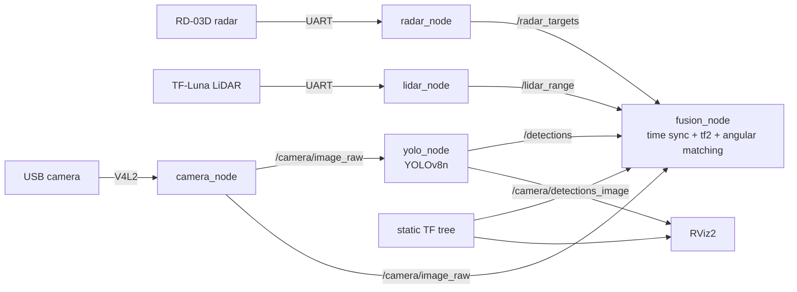

# Radar–LiDAR–Camera Fusion for Person Detection (ROS 2 Jazzy, Raspberry Pi 5)

A real-time, multi-sensor perception pipeline that fuses a **24 GHz mmWave radar**, a **single-point ToF LiDAR** and a **USB camera running YOLOv8** to detect people and estimate how far away they are. Built and tested on a Raspberry Pi 5 (Ubuntu 24.04, ROS 2 Jazzy) during my research internship at DTE 4 Calamity and Humanity Pvt Ltd.

The camera tells us *what* is in the scene (a person, and in which direction). The radar tells us *where* and *how far*, and it works regardless of lighting. The LiDAR gives an independent range check along the sensor boresight. The `fusion_node` time-aligns all the streams, moves radar targets into the camera frame with tf2, and pairs each radar target with a YOLO person by bearing angle.

## Highlights

- **Custom radar driver:** decodes the RD-03D's binary UART protocol (30-byte frames, sign-flag encoded fields) and switches it into multi-target mode (up to 3 targets).
- **REP-103 compliant:** the radar's native axes are swapped into the ROS convention (x forward, y left) before publishing, so every downstream bearing is correct.
- **Time synchronization:** four asynchronous topics (30 Hz camera, YOLO, 20 Hz radar, 100 Hz LiDAR) are aligned with `message_filters.ApproximateTimeSynchronizer`.
- **Proper extrinsics:** a static tf2 tree models the physical sensor offsets, and radar points are transformed into `camera_frame` before matching.
- **Angular association:** greedy nearest-bearing matching between radar targets and YOLO persons, with a 10° gate and no camera intrinsic calibration needed.
- **Edge-friendly:** YOLOv8n runs on the Pi 5 CPU, with an in-flight guard that drops frames instead of queueing them.

## Hardware

| Component | Interface | Notes |
|---|---|---|
| Raspberry Pi 5 | — | Ubuntu 24.04 LTS, ROS 2 Jazzy |
| AiThinker RD-03D mmWave radar (24 GHz) | UART `/dev/ttyAMA0` @ 256000 | Up to 3 targets, x/y in mm + speed |
| Benewake TF-Luna LiDAR | UART `/dev/ttyAMA1` @ 115200 | 0.2–8 m single-point range |
| Logitech Brio 105 USB camera | V4L2 `/dev/video8` | 640×480 @ 30 FPS, 49° HFOV |

Mounting: the camera's optical centre is the reference (`base_link`). The radar sits 1.5 cm to the left and the LiDAR 3 cm below.

## Architecture



### Topics

| Topic | Type | Publisher | Rate |
|---|---|---|---|
| `/radar_targets` | `geometry_msgs/PoseArray` | `radar_node` | ~20 Hz |
| `/lidar_range` | `sensor_msgs/Range` | `lidar_node` | ~100 Hz |
| `/camera/image_raw` | `sensor_msgs/Image` | `camera_node` | ~30 Hz |
| `/detections` | `vision_msgs/Detection2DArray` | `yolo_node` | limited by inference |
| `/camera/detections_image` | `sensor_msgs/Image` | `yolo_node` | limited by inference |

### TF tree

```
map
└── base_link            (camera optical centre)
    ├── camera_frame     (0, 0, 0)
    ├── radar_frame      (0, +0.015, 0)   1.5 cm left
    └── lidar_frame      (0, 0, -0.030)   3 cm below
```

## How the fusion works

1. **Sync:** `ApproximateTimeSynchronizer` (queue 200, slop 1.0 s) fires once it has one message from each of the 4 topics.
2. **Radar → camera frame:** each radar target is transformed with `tf2_ros.Buffer.transform()`. Range and bearing are then computed as `atan2(y, x)`, positive to the left. Targets outside the camera's ±24.5° FOV are dropped.
3. **Camera bearing:** for each YOLO `person`, the bounding-box centre pixel is mapped linearly to an angle across the 49° HFOV, using the same left-positive sign convention as the radar.
4. **Association:** each radar target is paired with the person at the closest bearing. It's a **MATCH** if the bearings differ by 10° or less.
5. **Output:** a per-frame report (radar targets, LiDAR range, persons, match results) plus a one-line ROS log summary:

```
MATCH  Radar T1 (bearing=+9.3°, dist=1.88 m)  <->  Person 1 (angle=+8.6°, conf=0.87)  Δ=0.7°
[fusion_node]: Radar(FOV)=1/2 | Persons=1 | LiDAR=1.92 m
```

## Build and run

```bash
# In your ROS 2 Jazzy workspace
cd ~/ros2_ws/src
git clone https://github.com/Sagar-0204/sensor_fusion.git
cd ~/ros2_ws
rosdep install --from-paths src --ignore-src -y
pip install ultralytics          # for yolo_node (or install it in a venv, see below)
colcon build --packages-select radar_lidar_fusion
source install/setup.bash

# Full stack: TF tree + all 5 nodes
ros2 launch radar_lidar_fusion sensors.launch.py

# If ultralytics lives in a separate venv:
ros2 launch radar_lidar_fusion sensors.launch.py yolo_python:=$HOME/venvs/yolo_env/bin/python3
```

Nodes can also be run one at a time, with their parameters overridden:

```bash
ros2 run radar_lidar_fusion radar_node  --ros-args -p port:=/dev/ttyAMA0 -p baud:=256000
ros2 run radar_lidar_fusion lidar_node  --ros-args -p port:=/dev/ttyAMA1 -p baud:=115200
ros2 run radar_lidar_fusion camera_node --ros-args -p device_index:=8
ros2 run radar_lidar_fusion yolo_node   --ros-args -p model_path:=yolov8n.pt -p confidence_threshold:=0.5
ros2 run radar_lidar_fusion fusion_node
```

`yolov8n.pt` is downloaded automatically by Ultralytics on the first run.

## Package layout

```
sensor_fusion/                 # ROS 2 package: radar_lidar_fusion
├── launch/sensors.launch.py   # static TF tree + all nodes
├── radar_lidar_fusion/
│   ├── radar_node.py          # RD-03D UART driver (multi-target, sign-flag decoding)
│   ├── lidar_node.py          # TF-Luna UART driver
│   ├── camera_node.py         # USB camera (OpenCV / V4L2)
│   ├── yolo_node.py           # YOLOv8n → vision_msgs/Detection2DArray
│   └── fusion_node.py         # time sync + tf2 + angular association
├── package.xml
└── setup.py
```

## Limitations and future work

- Matching uses bearing only, so two people at a similar angle but different ranges can't be told apart. Projecting radar points into the image and checking box overlap, or adding range gating, would fix this.
- The pixel-to-angle mapping is linear. Calibrated camera intrinsics would make it more accurate near the image edges.
- The 1.0 s sync slop is deliberately loose for bring-up and should be tightened once timing is characterised.
- Results are only logged. Publishing fused targets (for example as `visualization_msgs/MarkerArray`) would make them visible in RViz2 and usable by other nodes.
- Adding tracking (a Kalman filter per fused target) would smooth range and bearing over time.

## License

Apache-2.0
